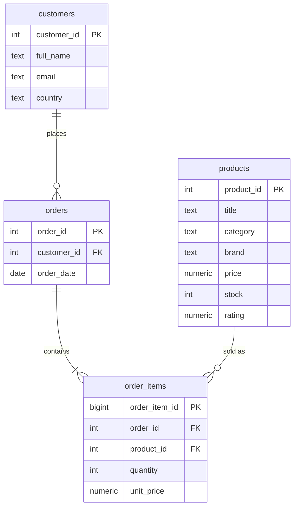

# E-commerce Data Pipeline

API → Parquet → cleaning → PostgreSQL. Collects product data from a public REST API,
cleans a messy sales CSV, and loads everything into a relational e-commerce model.

```
DummyJSON API ──► products.parquet ──┐
                                     ├──► clean_sales.py ──► sales_clean.csv ──► PostgreSQL
generate_sales.py ──► sales_raw.csv ─┘     (+ sales_rejected.csv)               products / customers
 (uses the same product IDs)                                                    orders / order_items
```

## Data sources
| Data | Source |
|------|--------|
| Products | `https://dummyjson.com/products?limit=50` (public, no API key) → `data/raw/products.parquet` |
| Sales | Synthetic CSV built by `src/generate_sales.py` from the API's product IDs (1–50), with injected errors |

## Quick start
```bash
python -m venv .venv && source .venv/bin/activate      # Windows: .venv\Scripts\activate
pip install -r requirements.txt
cp .env.example .env                                   # DB credentials
docker compose up -d db                                # PostgreSQL 16 (or use your own server)
python run_pipeline.py                                 # runs all 4 stages
pytest                                                 # unit tests for the cleaning logic
```
Run a single stage: `python run_pipeline.py --stage extract|sales|clean|load`.

## Stage 2 – Cleaning rules (`src/clean_sales.py`)
| Problem in raw CSV | How it is handled |
|---|---|
| Exact duplicate rows | Removed (logged to `sales_rejected.csv`) |
| Duplicate (order_id, product_id) lines | Keep first, reject rest |
| Missing order/customer/product ID, date or quantity | Row rejected (cannot be guessed) |
| Missing `unit_price` | Imputed from the API product price |
| Missing name / country / email | Filled from the customer's other rows, else `Unknown` / NULL |
| Wrong types: `"$19.99"`, `" 2 "`, `"4.0"`, `"two"` | Converted to numeric / int |
| Mixed date formats (`2026-03-01`, `01 Mar 2026`, `2026/03/01`) | Parsed to one `DATE` |
| Invalid / future dates | Rejected |
| Quantity ≤ 0 | Rejected |
| Product ID not in API data | Rejected (would break the foreign key) |
| Bad e-mail, upper case, spaces | Trimmed, lower-cased, invalid → NULL |

Every dropped row is saved with a `reject_reason`, and a cleaning report is printed.

## Stage 3 – Data model

`unit_price` is stored on the order line (price actually paid), separately from the catalogue `products.price`.
The loader is idempotent (`ON CONFLICT`), and loads parents before children.

## Demo query
```sql
SELECT p.product_id, p.title,
       SUM(oi.quantity * oi.unit_price) AS total_sales_value
FROM order_items oi JOIN products p USING (product_id)
GROUP BY p.product_id, p.title ORDER BY total_sales_value DESC;
```
More in `sql/queries.sql`. Open them with `docker compose exec db psql -U postgres ecommerce`.

## Project layout
```
run_pipeline.py        entry point          sql/schema.sql   tables, PK/FK
src/config.py          paths + DB settings  sql/queries.sql  analysis queries
src/extract_products.py   stage 1           tests/           pytest tests
src/generate_sales.py     stage 2a          docs/TEAMWORK.md branches, PRs, review
src/clean_sales.py        stage 2b          docs/PRESENTATION_OUTLINE.md
src/load_db.py            stage 3
```
